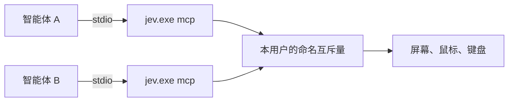

# Design

## Context

jev 现在只有一种用法：人在终端里运行 `clicker "目标" --act`。

```
终端
  └── clicker（cli.main）
        ├── config.load_dotenv(Path.cwd() / ".env")
        ├── RunConfig(out=runs/<时间戳>)
        ├── Context(ask=ask_user)          ask_user 用 input()
        └── runner.run(cfg, ctx_factory)
              ├── perception.capture / perceive    读屏，编号元素
              ├── decide                           TypeSafe 分类器
              ├── actions.perform                  click_item、fill_field、按键、滚动
              └── platform_adapter.desktop         macos.py 或 windows.py
```

已有的两层边界正好是 MCP 需要的两级工具：`runner.run(RunConfig, ctx_factory)` 是与命令行无关的整段循环；`platform_adapter.Desktop` 是全部感知与动作原语，`using(adapter)` 能在一段调用里换上包装。

商业产品的做法见 `proposal.md`。本次的安装形态仍是 Codex 在 Windows 上的那种：一个用户态 exe，按用户装到 `%LOCALAPPDATA%\Programs\jev\`，不注册服务。操作屏幕的代码就在 `jev mcp` 这个进程里，不再另起助手。

## Goals / Non-Goals

**Goals:**

- 其他智能体经 MCP 把一个目标交给 jev，得到答案和过程（VISION：「交接时带上过程」）。
- 调用方要亲自控制时，可以用 jev 的感知（编号元素加标注图）和动作原语。
- jev 与宿主分开安装：一个 `jev.exe`，智能体启动 `jev mcp` 之后，工具调用就在这个进程里执行。
- 现有 `clicker`、`clicker-inspect`、WAA、沙盒的用法与行为不变。

**Non-Goals:**

- 见 `proposal.md` 的「不在本次范围内」，其中包括 macOS 与演练模式。
- 不改感知管线、分类器请求、动作语义。

## Decisions

### 1. 单进程：`jev mcp` 直接操作屏幕



- 一个冻结产物 `jev.exe`。`helper/cli.py` 只分发 `mcp` 和 `status`。`jev mcp` 走 `helper/front.py`（FastMCP）。模块顶层只导入前端和 FastMCP；`Service`、平台适配器和感知在第一次工具调用时、在函数内部导入。导入边界测试保证 `helper.front` 的模块层不导入 `platform_adapter`、`perception`、`windows` 或模型，并且只有 `desk_lock` 导入 `win32event`。
- 第一次调用时 `Local._ensure` 依次做这几件事：把 stdout 和 stderr 指到 `state/jev.log`（这时 MCP 的 stdio 传输已经拿到了它自己的 stdout 句柄），读入用户目录的 `.env`，创建 `Service`，再用 `ancestors()` 算出 `Gate(host_apps(...))`。
- `call` 用 `run_in_executor` 执行 `service.call`。捕获到 `CancelledError` 时调用 `service.cancel(call_id)` 再重新抛出。`ToolFailure` 转成 MCP 工具错误 `"<kind>: <message>"`。
- 备选：两个进程，前端经命名管道把调用转给每用户一个的 `jev helper`。做过，然后合并掉：管道、线协议、对端签名、版本替换、`shutdown`、`jev stop` 和 10 分钟空闲退出都只为了把两个进程拆开。代价是每个智能体各加载一份模型，智能体重启 MCP 时要重新加载。
- 备选：Windows 服务。否决：服务跑在 session 0，SendInput 与 UI Automation 到不了用户桌面。

### 2. 本用户的命名互斥量

一台电脑同一时间只有一套鼠标和键盘，`platform_adapter.using()` 也不是线程安全的。每次调用先拿进程内的非阻塞锁，再非阻塞地拿 `Local\jev-desk-<用户 SID>`。任一把拿不到就返回 `busy`，不排队；互斥量没拿到时先放掉进程内的锁。两把锁都在 `finally` 里释放，异常路径也放。互斥量归线程所有，所以拿锁和放锁都在 `Service.call` 的同一个工作线程里完成。`WAIT_OBJECT_0` 和 `WAIT_ABANDONED` 都算拿到：后者是上一个持有者崩溃后系统交出来的。进程崩溃时，系统会释放互斥量。

`ToolFailure` 是普通异常，带 `kind` 和 `message`。`kind` 有：`forbidden`、`busy`、`stale_state`、`invalid_arguments`、`missed`（光标没到，或按元素点击被拒）、`aborted`、`not_found`（点名的应用拉不到前台）、`unsupported`（元素不能设值）、`not_configured`（密钥或 writer、driver 的环境变量不合法）、`not_supported`（这台机器跑不了桌面感知）。

这条路径不监听任何网络端口。

### 3. 元素编号与坐标

照 Codex：`get_app_state` / `inspect_screen` 生成新的 `state_id`（`secrets.token_hex(4)`，8 位十六进制），服务只保留最近一次的 `Screen` 与元素。按元素操作必须带当前 `state_id`，否则返回 `stale_state` 且不输入；任何输入，包括一次 `run_goal`，都会让当前状态过期。返回给调用方的框与接受的坐标都是屏幕点（points），与 `Desktop.click_at` 一致，另附 `window`、焦点字段和图片的像素比例。

- `get_app_state(app)` 先 `activate(app)`，拉不到前台返回 `not_found`，再读屏；`activate` 同样。`inspect_screen` 不激活任何应用。
- 元素上的左键单击走 `actions.click_item`：来自无障碍树的先按下，按下没成再点框中心（挡在前面的弹层会先关掉）。右键或双击不走无障碍树，直接点框中心。光标没到、或 `click_item` 报点击被拒，都返回 `missed`。
- `type_text` 给了元素就先用 `click_item` 点它，再逐键输入，不设值。`set_value` 只对无障碍元素调用 `ax_set_value`，没有控件或设值失败返回 `unsupported`。

### 4. 门禁：没有演练，也不提问

用户要求去掉所有默认演练，并且 jev 只作为工具被调用：不向用户提问，也不向智能体发反向请求。`run_goal` 固定 `act=True`，`ask=None`，原语直接动作。`run_goal` 的其余构造与 `cli.main` 相同：`driver_steps` 取 `config.driver_steps()`，所以 `CLICKER_DRIVER` 打开时，分类器停在目标之前由更强的模型接手，和 `clicker --act` 一样。`parse.runtime.unsupported()` 有理由时返回 `not_supported`。没有 `TYPESAFE_API_KEY`，或 `CLICKER_WRITER_VISION`、`CLICKER_DRIVER`、`CLICKER_DRIVER_STEPS` 不合法，返回 `not_configured`。返回取 `run.json` 的 `outcome`、`answer`、`goal_achieved`、`steps_taken`、`history`、`handoffs`、`questions`、`calls`、`seconds`，加上 `run_folder`；还有最后一屏时附标注图。写手收到 `user_can_be_asked=False`，需要澄清时只能停下，由结果说明原因。

安全全部由 `helper/guard.py` 的 `GuardedDesktop` 负责：每次调用都用 `using()` 套在当前适配器外，读操作直接透传，每个输入（点击、滚动、按键、输入、清空、无障碍按下、聚焦、设值、激活、打开 URL）先按目标应用过一道 `Gate`：

1. 永远拒绝：终端与 shell、UAC、锁屏与登录界面、设置、任务管理器、注册表编辑器、jev 自身，以及宿主智能体（本进程的祖先进程，去掉 `explorer` 等系统进程）。
2. 只点：IDE 与代码编辑器可以点击和滚动，不能输入或按键。
3. 其余应用不问，直接操作。没有审批文件。

与 Codex 不同，浏览器不设为只看：jev 最主要的用途就是操作浏览器。`open_path` 一律拒绝。被拒时抛 `Denied`，它是 `Abort` 的子类。原语的 `Denied` 由 `Service.call` 收成 `forbidden`，输入还没发出。`run_goal` 里的 `Denied` 被 `runner.run` 当成 `Abort` 接住：动作之前结束，`run.json` 的 `outcome` 记为 `aborted (...)`，这次工具调用返回的是这份运行记录，不是 `forbidden`。前台没有应用时同样拒绝。

底层原语绕过了分类器，所以工具说明里写明：调用方为每个原语动作负责；被拒绝的应用返回 `forbidden`，不会出现确认提示。

### 5. 取消与急停

`GuardedDesktop.check_abort` 先查本次调用的取消事件，再调原适配器（左上角急停）；`sleep_watching` 轮询它。智能体取消这次 MCP 调用时，`Local.call` 收到 `CancelledError`，直接设置这次调用的取消事件，下一次输入前停下。取消抛出 `Abort("cancelled by the client")`，原语返回 `aborted`，`run_goal` 照常写完 `run.json`。关掉智能体就是关掉这个进程，调用随之结束，互斥量由系统释放。

### 6. 不反控

调用方向只有一个：智能体调用 `jev mcp` 的工具，在这个进程里等结果。没有 elicitation，没有挂起令牌，没有 `expired`。

### 7. 用户目录与安装

| | 位置 |
|---|---|
| `.env` | `%LOCALAPPDATA%\jev\` |
| run 文件夹 | `%LOCALAPPDATA%\jev\runs\<时间戳>\` |
| 日志 | `%LOCALAPPDATA%\jev\state\jev.log` |
| 程序 | `%LOCALAPPDATA%\Programs\jev\jev.exe`，旁边是 `_internal\`、`models\`、`version.txt`、`mcp-config.json` |

`JEV_HOME` 可以整体移走日志、run 和 `.env`。它不移动程序目录。`clicker` 的默认行为不变。

没有 `jev install`，也没有 `runtimes`、`current.json` 或目录联接。分发物是 Inno Setup 的 `jev-setup-<版本>.exe`：`PrivilegesRequired=lowest`，固定装到 `{localappdata}\Programs\jev`，不需要管理员。升级和卸载时，`CloseApplications` 会关掉仍在运行的 `jev.exe`；正在进行的调用也会被中断，智能体要重新启动 MCP。没有 `jev stop`。完成页显示 MCP 配置，并把同样内容写入 `mcp-config.json`。命令是安装目录里 `jev.exe` 的绝对路径，参数是 `mcp`。再次运行安装程序即升级，目录不变，已写好的 MCP 配置不用改。`jev status` 打印版本、`sys.executable`、用户目录，以及 exe 旁边有没有 `models\`。

打包：`packaging/windows/jev.spec`（PyInstaller，单目录，`console=True`，包含 MCP 服务与 FastMCP，`collect_all("fastmcp")`，并对 `fastmcp`、`fastmcp-slim`、`mcp` 做 `copy_metadata`）。`scripts/build-helper.ps1` 构建、可选 `signtool` 签名、写 `version.txt`，再用 `HF_HUB_CACHE` 跑 `clicker-models fetch` 把模型放到 `build\helper\models`（必须是实体文件，不能是符号链接），然后用 Inno Setup 的 `ISCC` 编译 `packaging/windows/jev.iss`（`lzma2/max`，`DiskSpanning=yes`）。模型不经过 PyInstaller。冻结进程在 `jev_entry.py` 里、导入 huggingface_hub 之前，若 exe 旁边有 `models\`，就 `setdefault` `HF_HUB_CACHE` 并设置 `HF_HUB_OFFLINE=1`。

- 备选：`jev install` 加版本目录和联接。否决：用户要的是一次安装就能用，安装程序覆盖固定目录，MCP 路径不用改。
- 备选：模型不进包，第一次使用再下载。否决：那样安装完还不能用。代价是安装包约 3 GB，代码更新也要带上模型。
- 备选：升级时若有调用在跑就中止安装、不关进程。合并成单进程之后没有单独的助手可查询空闲，安装程序直接关掉仍占用文件的 `jev.exe`。

### 8. 测试与机器守护

- `tests/conftest.py` 的守护只加不减：`desk_lock.open_mutex` 在测试里拒绝；`tests/test_no_real_machine.py` 逐项断言。没有 pywin32 的系统上用桩模块。互斥量的等待常量写在模块里，导入 `desk_lock` 时不去读桩模块的属性。
- 门禁、守卫、服务在桩的 `Desktop` 与桩的感知上测试。前端用 `fastmcp.Client` 连 `build_server(Local(service=...))`：十个工具、普通应用直接操作、永不操作的应用和宿主智能体返回 `forbidden`、取消在下一次输入前停下、互斥量拿不到时 `busy` 且没有输入、调用里的 `print` 进 `jev.log` 而不打断 MCP、第一次调用前不创建 `Service`。服务测试覆盖两把锁的顺序和异常路径上的释放。`helper`、`stop`、`install` 都不是子命令。
- 导入边界：`helper.cli` 的 `mcp` 路径只导入 `helper.front`；`helper.front` 在模块层不触及平台与模型；只有 `desk_lock` 导入 `win32event`。

## Risks / Trade-offs

- **[没有演练，也不提问]** → 硬拒绝列表以外的应用会被直接操作，安全只靠调用方智能体和这份列表；宿主与终端永远不可操作。写手不能再问用户，遇到要澄清的情况只能停下。
- **[未在真实 Windows 上运行]** → 互斥量、安装程序、冻结后的模型路径都只经过离线测试与桩；首次在 Windows 上验证需要维护者批准并亲自运行。原生库如果直接写文件描述符 1，仍然可能弄脏 MCP 的 stdout，也只能在 Windows 上确认。
- **[每个智能体一份模型]** → 内存是 N 份。智能体重启 MCP 时要重新加载。
- **[冻结 torch 与 FastMCP 的体积，再加上模型]** → 安装包约 3 GB；FastMCP 带进 starlette、uvicorn 等依赖，版本锁在 4.2.0。PyInstaller 的隐藏导入可能要在首次构建时补。代码更新也要重新分发模型。
- **[升级会关掉正在运行的 jev]** → 正在进行的调用被中断，智能体要重新启动 MCP。
- **[run_goal 运行时间长]** → 暂无逐步进度通知；调用方可以取消。
